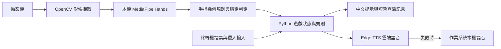

# Edge AI Werewolf Moderator｜手勢狼人殺法官

用攝影機辨識手勢、繁體中文語音與畫面提示，協助主持實體狼人殺。目標是減少一名玩家必須全程擔任法官的負擔，讓夜間操作不必透過口頭報號。

**目前狀態：10 人局開發原型。** 夜間角色流程與白天結算已實作，白天投票仍由操作員輸入結果。macOS 上已做元件測試與部分遊戲流程測試；完整 10 人、多夜遊戲、Windows/Linux 與 ASUS 競賽硬體仍待驗證。

> **English overview:** A prototype assistant for in-person Werewolf games, combining local hand-landmark inference, gesture-based night actions, Chinese speech, and a deterministic game controller. It currently runs on a laptop, uses manual daytime vote entry, and has not yet been deployed on ASUS UGen hardware. Cloud speech is attempted first, with local speech fallback.

## 專案定位與架構

適用情境：朋友聚會、校園社團與桌遊活動。角色牌與玩家編號由參與者事先分配，程式負責引導、接收操作與更新存活狀態；目前不會自動發牌、辨識玩家身分或統計實際票數。



- **AI 部分：** MediaPipe 預訓練手部關鍵點模型在本機推論；沒有自訓模型、LLM 或生成式 AI 遊戲裁判。
- **規則部分：** 手勢分類與遊戲裁決是 Python 規則。`max_num_hands=10` 是最多偵測手數，並不代表能穩定辨識 10 名玩家。
- **模型資訊：** 使用 `mediapipe==0.10.9` 的 `mp.solutions.hands`，最低偵測信心值為 `0.7`；目前未整合 ASUS/Hailo/Intel 推論後端，也沒有硬體效能數據。

## 環境與依賴

建議 **Python 3.11、可開啟桌面視窗的作業系統、攝影機與喇叭**。初次安裝需要網路；雲端語音也需要網路。純 SSH、無桌面環境及 WSL 的攝影機／音效支援未驗證。

本機測試環境為 Apple M1、Python 3.11。不要直接使用目前系統的 Python 3.14 建立環境：此專案鎖定的 MediaPipe 舊版不提供該版本的安裝 wheel。[MediaPipe 0.10.9 套件檔案](https://pypi.org/project/mediapipe/0.10.9/#files)

[requirements.txt](requirements.txt) 記錄目前開發環境的直接依賴版本，尚非包含全部間接依賴的跨平台 lockfile。

| 套件 | 用途 |
| --- | --- |
| `mediapipe==0.10.9` | 舊版 `mp.solutions.hands` 手部關鍵點推論 |
| `opencv-contrib-python==4.11.0.86` | `cv2`、攝影機、畫面與鍵盤事件；亦為 MediaPipe 依賴 |
| `numpy==1.26.4` | 影像陣列；避免舊版模型與 NumPy 2 的相容性問題 |
| `pillow==12.3.0` | 中文字型與畫面文字繪製 |
| `edge-tts==7.2.8` | Microsoft Edge 線上語音服務；不是 Azure Speech SDK |
| `pygame==2.6.1` | 雲端語音音檔播放 |
| `pyttsx3==2.99` | Windows 本機語音；目前程式在所有平台都會匯入 |

**不要同時安裝多個 OpenCV 發行套件**（例如 `opencv-python`、`opencv-contrib-python`、headless 版本）；本專案使用上表的 contrib 版本，需要 GUI。

額外系統元件：

- **macOS：** Python 3.11 的 Tk 支援、內建 `/usr/bin/say` 與 `Meijia` 語音；文字使用 STHeiti／PingFang 字型。雖然 macOS 訊息已改用 OpenCV，程式仍會匯入 `tkinter`。
- **Windows：** 安裝 Python 時包含 Tcl/Tk；本機語音需可用的中文系統語音，字型使用微軟正黑體。完整平台測試待完成。
- **Linux：** 與 Python 版本相符的 Tk、`espeak`、Noto CJK 字型及可用的桌面／音效服務。例如 Debian/Ubuntu 常見套件為 `python3-tk`、`espeak`、`fonts-noto-cjk`，但需依發行版確認 Python 3.11 的套件來源。

## 安裝與啟動

以下指令在專案根目錄執行。

### macOS（Homebrew）

```bash
brew install python@3.11 python-tk@3.11
"$(brew --prefix python@3.11)/bin/python3.11" -m venv venv
./venv/bin/python3 -m pip install --upgrade pip
./venv/bin/python3 -m pip install -r requirements.txt
./venv/bin/python3 main.py
```

若已建立 Python 3.11 的 `venv`，只需執行最後兩行。不需要依賴 shell 是否已啟用虛擬環境。

### Windows（PowerShell）

先安裝 Python 3.11（含 Tcl/Tk），再執行：

```powershell
py -3.11 -m venv venv
.\venv\Scripts\python.exe -m pip install --upgrade pip
.\venv\Scripts\python.exe -m pip install -r requirements.txt
.\venv\Scripts\python.exe main.py
```

### Linux

先備妥 Python 3.11、venv、Tk、中文字型與 `espeak`，再執行：

```bash
python3.11 -m venv venv
./venv/bin/python3 -m pip install --upgrade pip
./venv/bin/python3 -m pip install -r requirements.txt
./venv/bin/python3 main.py
```

### VS Code

執行 **Python: Select Interpreter**，選擇專案的 `venv/bin/python3`（Windows 為 `venv\Scripts\python.exe`）。若使用 Code Runner，它有自己的執行命令設定，請確認同樣指向此環境。程式需要終端機接受白天輸入，請勿只在唯讀 Output 面板執行。

## 如何玩

### 開局準備

1. 準備 10 名玩家與 1～10 號座位：**3 狼人、1 女巫、1 預言家、1 獵人、4 村民**。角色由真人或外部工具私下分配。
2. 攝影機放在能清楚看見操作手勢的位置；避免逆光、遮擋與其他人同時舉手。先讓玩家熟悉下表。
3. 允許執行程式的應用程式使用攝影機，確認正確的音訊輸出。螢幕只讓當前角色看到；其他人按指示閉眼。
4. 執行 `main.py`，跟隨語音與畫面指示。保留一名操作員在白天輸入投票結果；目前無法完全免人工操作。

### 夜晚與白天

| 階段 | 玩家／操作員的動作 |
| --- | --- |
| 首夜狼人報到 | 三名狼人各出示一個不同的座位號碼；畫面需同時辨識到 3 個有效手勢 |
| 狼人選擇 | 由一人出示目標號碼；倒讚代表空刀 |
| 首夜神職報到 | 女巫、預言家、獵人輪到自己時出示座位號碼；程式檢查範圍及已使用號碼 |
| 女巫操作 | 讚代表解藥、號碼代表毒藥、倒讚代表不使用；每晚最多一種藥，不可自救 |
| 預言家操作 | 出示存活玩家號碼，螢幕短暫顯示狼人／好人 |
| 獵人階段 | 顯示能否開槍；被女巫毒死時不能開槍 |
| 白天 | 真人討論與投票後，在終端機輸入被放逐的號碼；`0` 表示平票／不放逐 |
| 獵人開槍 | 若流程觸發開槍，在終端機輸入目標號碼；`0` 表示不開槍 |
| 下一夜 | 終端機按 Enter 繼續 |

手勢需要保持約 **3 秒**；判定含約 **0.5 秒**的短暫辨識中斷容忍。除了狼人報到，其他選擇通常只接受 **1 個有效手勢**，多餘的手會妨礙確認。

### 手勢對照

以下是程式實際使用的伸指組合，並非所有地區的數字手勢都適用。朝下的食指可能被辨識為 11，請注意方向。

| 輸出 | 手勢 |
| --- | --- |
| 1 / 2 | 食指／食指＋中指 |
| 3 | 食指＋中指＋無名指，或中指＋無名指＋小指 |
| 4 / 5 | 拇指以外四指／五指張開 |
| 6 | 拇指＋小指 |
| 7 / 8 / 9 | 拇指＋食指／再加中指／再加無名指 |
| 10 | 握拳 |
| 0 / -1 | 讚／倒讚；由目前角色解讀用途，不是玩家號碼 |
| 11 / 12 | 食指朝下／食指與中指朝下；辨識器支援，但目前 10 人局不接受為玩家號碼 |

攝影機視窗取得焦點時按 `q` 可離開手勢等待；終端機可按 `Ctrl+C` 中止。沒有存檔／續局功能，重新執行會開始新局。

### 目前勝利規則

好人獲勝：所有狼人出局。狼人獲勝：所有神職或所有村民出局（屠邊）。目前沒有「狼人人數大於等於好人就立即獲勝」的判定。獵人結算順序等邊界情境仍需修正，詳見下節。

## 開發進度與已知限制

**更新：2026-10-12。**「已實作」指程式存在該流程，並不代表完成完整實戰驗收。

| 項目 | 狀態與證據範圍 |
| --- | --- |
| 手部辨識、數字分類與穩定確認 | 已實作；已有實機流程操作，未量測準確率、距離與多人遮擋影響 |
| 首夜角色報到、號碼範圍與重複檢查 | 已實作 |
| 夜間行動、用藥、查驗與白天投票輸入 | 已實作；仍有下列規則邊界問題 |
| macOS 本機中文語音 | `say` 備援已測試連續呼叫成功；音量及輸出裝置需現場確認 |
| 中文畫面與 macOS 訊息 | 已檢視中文渲染；連續訊息視窗測試通過，macOS 避開 Tk/OpenCV 衝突 |
| Windows／Linux 路徑 | 已有程式分支，尚未完成實機驗收 |
| 完整 10 人多夜遊戲、效能量測 | 待完成；沒有宣稱完整通關或低延遲數據 |
| ASUS 加速器部署、離線模式開關、自動投票 | 尚未實作 |

優先處理的已知問題：

- 女巫存活但兩瓶藥都用完時，狀態可能停在 `WITCH`，導致跳過預言家查驗；需補齊狀態轉移。
- 空刀夜仍可消耗解藥；需依選定規則限制。
- 部分出局流程先判定勝負才處理獵人開槍，可能提早結束遊戲；需定義並測試結算順序。
- 神職死亡時有固定等待，但其他角色操作時間可變，不能保證不洩漏角色存活資訊。
- `CameraError` 已提供明確原因，但目前 `main.py` 沒有完整捕捉及 `finally` 清理；攝影機中斷仍會終止本局。
- 每句語音仍先嘗試雲端；連續斷網／403 可能反覆延遲。本機語音失敗會改為終端機字幕，音效初始化失敗則可能更早終止程式。
- 雲端語音的暫存檔僅在成功路徑刪除；失敗時的清理仍待補齊。

## 常見問題

| 現象 | 檢查方式 |
| --- | --- |
| `ModuleNotFoundError` | 用專案 `venv` 的 Python 執行 `-m pip install -r requirements.txt`；確認 IDE 沒有切回系統 Python |
| 找不到 MediaPipe 安裝版本／沒有 `mp.solutions` | 使用 Python 3.11 與固定的 MediaPipe 0.10.9；不要直接升級到新版 API |
| 攝影機找 iPhone／讀不到畫面 | `main.py` 的 `cv2.VideoCapture(0)` 使用裝置索引，0 不保證是內建鏡頭；測試其他索引。macOS 相機權限不控制裝置排序 |
| 不想使用 iPhone 鏡頭 | 在 iPhone「設定 → 一般 → AirPlay 與接續互通（或 Handoff）」關閉「接續互通相機」，重新啟動程式 |
| `edge-tts` HTTP 403 | 線上語音服務拒絕連線；程式應使用本機備援。不是攝影機或 Python 版本的錯誤 |
| 沒有聲音 | 檢查輸出裝置／靜音；macOS 可執行 `say -v Meijia '語音測試'`；Linux 檢查 `espeak`，Windows 檢查中文系統語音 |
| 中文缺字／找不到字型 | 檢查 `chinese_font()` 的候選路徑；Linux 安裝 Noto CJK；不要以 Pillow 預設字型替代中文 |
| macOS `NSApplication macOSVersion` 當機 | 使用目前 macOS 的 OpenCV 訊息分支；不要在 OpenCV 視窗後重新建立 Tk 視窗 |
| 一直等待手勢 | 確认畫面中的有效手數符合要求，號碼合法、光線足夠，並保持姿勢約 3 秒 |

## 資料與隱私界線

攝影機影像在目前程式內交給本機 MediaPipe 處理，沒有錄影存檔或影像上傳流程。`speak()` 的播報文字會送至 Edge TTS 線上服務，並印到終端機；因此目前不是嚴格的全離線系統。

查驗等訊息由 `show_message()` 顯示，不主動印到終端機，約 3 秒後清除／關閉。這不代表防截圖或絕對保密：現場旁觀者、螢幕分享、錄影及手勢畫面仍可能暴露資訊。測試或展示時請事先安排螢幕視角與參與者同意。

## 黑客松定位與準備

目標活動：[ASUS UGen AI League Innovation Hackathon 官方網站](https://contest.bhuntr.com/en/39jg9vimiynrhlksze/home/)。以下賽事摘要於 **2026-10-12** 核對官方頁面；後續公告與報名系統為準，截止時刻及時區需再次確認。

**Official requirements at a glance:** Stage I is due October 14, 2026: a proposal deck of at most 20 main-body pages and an unlisted YouTube demo of at most 3 minutes, with a GitHub documentation link. Designated hardware is not required for Stage I. Stage II requires the selected platform. Online finals are due December 4, including a demo up to 10 minutes and repository documentation, architecture, model information, and performance data. Onsite decks are due December 10; finals are December 19. Judging weights: innovation 30%, feasibility/commercial potential 35%, practical value 25%, presentation 10%. Teams have 1–5 adults and choose one theme, battlefield, and participation format. The rules restrict previously public, exhibited, or submitted work and include licensing provisions; review these with the organizer before submission. [Official rules](https://contest.bhuntr.com/en/39jg9vimiynrhlksze/home/)

**本專案的提案方向（建議，尚非已確認報名選擇）：** Everyday AI；Battlefield Lightning／ASUS UGen300。實體聚會中的免口頭夜間操作與本機視覺處理，是可展示的使用情境。這是專案方向判斷，不代表主辦方已認定符合資格。

目前 Mac 原型只提供軟體與互動基準，**沒有使用 ASUS UGen300 加速**。若選擇此賽道，需要確認主機作業系統與 SDK 支援、模型轉換及可用算子，將合適的視覺推論部署到指定硬體，並比較與現有基準的正確率、延遲與資源消耗；不能假設安裝 MediaPipe 就會自動使用加速器。

提交前工作清單：

- [ ] 團隊確認主題、賽道與線上／現場形式，填妥成員與分工。
- [ ] 向主辦方釐清既有 GitHub 公開紀錄是否影響原創／未公開要求；確認程式、模型、素材授權。
- [ ] 撰寫提案：實際使用痛點、目標使用者、可驗證的效益、架構與硬體移植計畫。
- [ ] 錄製短 demo：角色報到 → 夜間選擇 → 私密查驗 → 白天輸入，清楚標示人工操作及尚未完成部分。
- [ ] 補充模型版本、硬體／環境、測試方法與原始量測結果；目前不得填入推測的效能提升。
- [ ] 將 README、架構圖與模型資訊連結至提案；確認提交連結可以由評審開啟。

## 擴充路線

| 優先序 | 工作 | 完成標準 |
| --- | --- | --- |
| P0：可靠遊戲流程 | 修正女巫與獵人結算、攝影機清理，拆分 UI 與規則 | 規則測試涵蓋用完藥、空刀、死亡神職與獵人終局；實測完整多夜遊戲 |
| P0：穩定展示 | 攝影機選單、明確本機語音模式、暫存檔清理、錯誤提示 | 不修改程式即可選鏡頭／語音；斷網仍完成 demo |
| P1：競賽硬體 | 調查 UGen SDK 與模型支援，建立可替換推論後端 | 指定硬體實跑並留下版本、部署步驟及對照數據 |
| P1：可量測品質 | 手勢資料與測試情境、多手遮擋、距離、光線、左右手 | 報告每類手勢混淆、誤接受率、辨識／確認延遲、FPS、CPU／記憶體 |
| P2：遊戲擴充 | 可配置板子、守衛／白癡等角色、規則選項 | 配置、角色流程與勝負規則同步更新，不只更改人數常數 |
| P2：降低人工操作 | 座位對應、全自動投票、確認與撤銷介面 | 不將一隻手直接視為唯一玩家；避免重複投票並可人工修正 |
| P2：體驗與推廣 | 引導教學、英文介面、可及性操作、背景音效 | 新玩家可自行完成教學，音效不遮蓋播報且不洩漏角色資訊 |

評估時把 **模型每幀推論時間**、**3 秒手勢確認時間**與**語音等待時間**分開記錄。任何自訓或替換模型都應補上資料來源、授權與驗證方式。

## 檔案與協作

```text
main.py             遊戲角色、夜晚流程、白天輸入與勝負判定
ai_moderator.py      視覺、手勢、語音與訊息顯示
requirements.txt    目前直接依賴版本
README.md           安裝、操作、狀態與提案方向
```

修改時請建立功能分支，說明解決的問題、測試平台與驗證結果；不要提交 `venv/`、快取、私人遊戲資料或憑證。新增依賴時同步更新 `requirements.txt`。目前沒有專案授權檔；團隊需另行確認授權方式及第三方套件／模型條款，不能僅因放在 GitHub 就宣稱可任意再利用。
